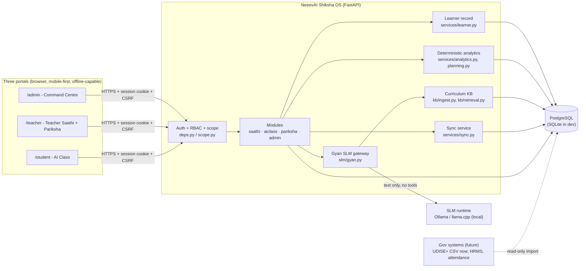
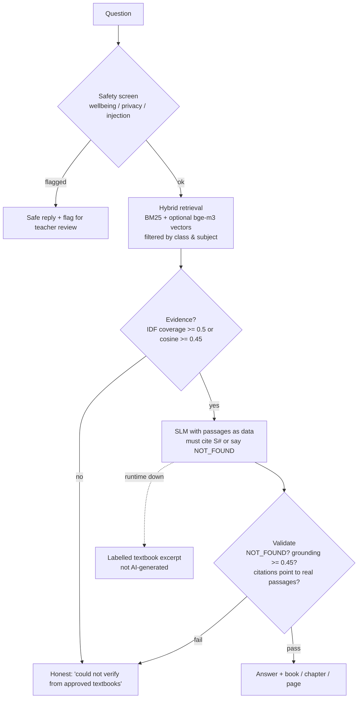

# HAMAR SHIKSHA — Architecture

**One Gyan SLM + one curriculum knowledge base + one continuous learner record + four connected modules + three role-specific portals.**

Module names (NeeevAI Shiksha OS, Gyan SLM, Teacher Saathi, AI Class, Pariksha Engine,
Command Centre) are proposed names, configurable in `HS_MODULE_NAMES` / `app/config.py`.

## 1. System context



## 2. The shared learner record (information captured once)

```mermaid
sequenceDiagram
  participant St as Student (AI Class)
  participant P as Pariksha Engine
  participant L as Learner record
  participant I as Insights (rules engine)
  participant Te as Teacher Saathi
  participant C as Command Centre
  St->>P: submit assessment (online or queued offline)
  P->>P: deterministic scoring; uncertain items -> teacher review
  P->>L: learner_event(assessment_result) [only when final]
  L->>L: update learner_competencies (per learning outcome)
  L->>I: refresh practice suggestions / class gaps
  I-->>St: targeted practice (AI Class)
  I-->>Te: weekly priorities + remediation draft (Teacher Saathi)
  P->>C: nightly snapshot -> aggregate school metrics
```

Every attendance mark, assessment result, activity/practice completion, lesson read and
approved intervention writes one idempotent `learner_events` row (`event_uid` unique). Topic
progress (`learning_progress`) and competencies (`learner_competencies`) are derived from those
events; dashboards read aggregates, never recompute from chat text.

## 3. Gyan SLM answer pipeline



The SLM never sees names, IDs, marks or school codes, has no tools and cannot query the
database, grant permissions or change records. All official numbers (attendance, scores,
rankings, planned/taught/learned, correlations) come from SQL/Python, never from the model.

## 4. Offline-first operation

```mermaid
sequenceDiagram
  participant B as Browser / device
  participant Q as IndexedDB outbox
  participant API as /api/sync
  participant Svc as Same services as online
  Note over B: offline: cached shell (service worker)<br/>+ cached bundle (quizzes, rosters, plans)
  B->>Q: queue event {event_uid, type, payload, created_at}
  Note over B: connectivity returns
  B->>API: push(device_uid, events)
  API->>API: authenticate user + device (not revoked, same school)
  API->>Svc: validate & apply with the user's own permissions
  Svc-->>API: accepted / duplicate / conflict / rejected
  API-->>B: per-event results; outbox cleared; errors shown
```

Conflict rules (documented in `services/sync.py`): attendance - latest client timestamp wins;
assessment - first submission wins; activity - best score kept; milestone - idempotent.
Logout wipes the outbox, the cache and the cached profile from the device.

**Deployment profiles**

| Profile | Where the SLM runs | Notes |
|---|---|---|
| School node (ICT lab / smart-class PC) | Local Ollama or llama.cpp on the same PC/LAN | Whole stack via `docker compose`; works with no internet; syncs to the state server when connected (state-level replication is a roadmap item, see LIMITATIONS) |
| Central (district/state data centre) | GPU/CPU inference servers behind the API | Browsers on low-end phones use it when online; `HS_SLM_RUNTIME=llamacpp` for production servers |
| Low-end Android browser | None on device | Offline: cached lessons/quizzes, attendance & answers queued; tutor needs connectivity to a node |
| Capable Android device | Not implemented | On-device inference (llama.cpp Android) needs a native app; roadmap |

## 5. Data model (46 tables)

Core: `users, roles, user_role_assignments, districts, blocks, schools, school_code_registry,
teacher_profiles, student_profiles, class_sections, subjects, teacher_class_assignments,
student_enrollments, attendance_records, assignments, assignment_submissions, assessments,
assessment_results, learning_activities, activity_completions, learning_progress,
ai_recommendations, ai_interactions, school_performance_snapshots, school_reports, audit_logs`.

Platform additions: `curriculum_documents, curriculum_chunks, learning_outcomes,
academic_calendars, lesson_plans, teaching_milestones, class_sessions, questions, answer_keys,
learner_competencies, remediation_plans, teacher_training_modules, training_completions,
learner_events, device_registry, synchronization_events`, plus `auth_sessions,
login_attempts, password_reset_tokens, timetable_slots`.

Migrations: `migrations/versions/0001_initial_schema.py` (Alembic). `python -m app.cli
schema-sql` prints PostgreSQL DDL.

## 6. Key design decisions

| Decision | Choice | Why |
|---|---|---|
| Primary AI | Local open-weight 1.5-3B SLM via a runtime adapter | Offline, no per-use cost, data stays in state infrastructure; see `docs/MODEL_SELECTION.md` |
| Grounding | RAG + deterministic citation/grounding validation | Small models hallucinate; the check makes "verified" mean something |
| Analytics | SQL/Python only | Official figures must be reproducible and auditable |
| Frontend | Vanilla JS, no build step (not Next.js) | ~20 KB gzipped per page for 2G/3G phones, runs from a school PC without Node; strict CSP. A React/TS rewrite is possible later without API changes |
| Auth | Server-side sessions, httpOnly cookies, CSRF tokens | Revocable, no tokens in JS-readable storage |
| Learner record | Append-only events + derived tables | Same facts reused by every module; idempotent sync |
| Cloud LLM | Optional, off by default (`HS_SLM_RUNTIME=anthropic`) | Spec: not the default for student interactions |
